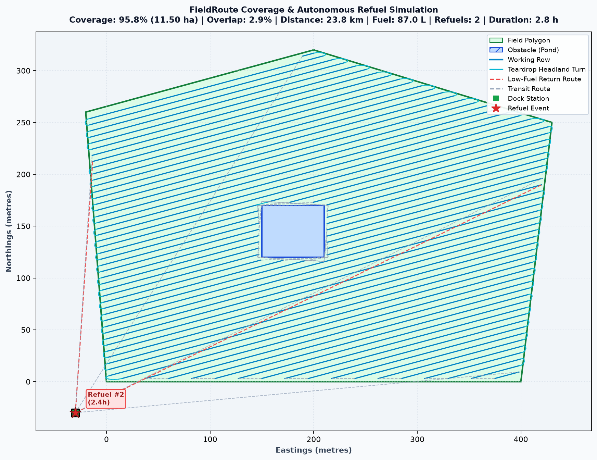

# FieldRoute 🚜

[](https://www.python.org/downloads/)
[](tests/)
[](LICENSE)
[](https://zianiwarhead.github.io/FieldRoute/)

> **Autonomous Tractor Coverage Path Planning (CPP) & Fuel/Battery Return-to-Dock Logistics Simulator.**

FieldRoute is an algorithmic mission planning and operational logistics simulation pipeline designed for autonomous agricultural vehicles (such as electric tractors, autonomous retrofits, and robotic implements). 

It models the entire field operation purely in Python using computational geometry (`Shapely`, `NetworkX`, `NumPy`, `Matplotlib`) with **zero hardware requirements**.

---



---

## 🚀 Key Autonomy Features

### 1. Inset Boundary & Obstacle Clearances
- Takes arbitrary polygonal boundaries (e.g. GPS boundary poles) and interior obstacles (ponds, tree groves, rocks).
- **Inward-buffers** the perimeter by half implement width ($W / 2$) to keep centerlines and implements strictly inside field boundaries.
- **Outward-buffers** obstacles to guarantee vehicle safety clearance.

### 2. Optimal Pass Angle Search
- Sweeps candidate row orientations every $5^\circ$ across $0^\circ \dots 180^\circ$.
- Evaluates total path cost (working rows + headland turns + obstacle detours) to select the most energy-efficient driving angle.
- Decomposes into boustrophedon (snake) swaths with an adjustable safety overlap margin (default $3\%$).

### 3. Realistic Teardrop / Omega ($\Omega$) Headland Turns
- Real ag tractors with towed implements cannot pivot on a dime.
- When pass spacing is narrower than the tractor's turning diameter ($W < 2 R_{\min}$), FieldRoute automatically generates smooth **Cubic Bézier Teardrop / Bulb Turns** extending into the headland margin, avoiding implement drag and soil compaction.

### 4. Visibility-Graph Obstacle Avoidance Routing
- Whenever transitioning between rows split by an obstacle or driving to/from the base station, FieldRoute computes the shortest collision-free path around the obstacle perimeter using a **visibility graph** and Dijkstra pathfinding.
- **Guaranteed zero transit paths cut across ponds or restricted zones.**

### 5. Dynamic Fuel / Battery Return-to-Dock Protocol
- Before committing to each row pass, FieldRoute evaluates:
  $$\text{Energy Required} = \text{Burn}_{\text{to\_row}} + \text{Burn}_{\text{work\_row}} + \text{Burn}_{\text{to\_dock}} \times (1 + \text{Reserve})$$
- If current fuel or battery state-of-charge (SOC) is insufficient to finish the row and return safely to base, FieldRoute detours to the dock, pauses for a 5-minute automated swap/refill cycle, and resumes from the exact row start.
- Supports both **stationary base stations** and **autonomous mobile tenders** (fuel/battery trucks following perimeter waypoints via a dynamic fixed-point rendezvous solver).

### 6. Interactive Browser Telemetry Dashboard
- Exports an all-in-one HTML5 dashboard ([`fieldroute_dashboard.html`](fieldroute_dashboard.html) / [`index.html`](index.html)) with playback controls ($1\times \dots 60\times$), timeline scrubber, live fuel gauge, active low-fuel warnings, and an animated vehicle position/beacon.

---

## 📊 Mission Summary Output

```text
==========================================================
       FIELDROUTE AUTONOMOUS TRACTOR MISSION SUMMARY      
==========================================================
 Optimal Pass Angle     : 15 deg (73 coverage passes)
----------------------------------------------------------
 FIELD & COVERAGE
  * Total Field Area    : 12.30 ha (123,000 m2)
  * Net Workable Area   : 12.00 ha (120,000 m2)
  * Covered Area        : 11.50 ha (95.8% field coverage)
  * Total Swath Swept   : 118,435 m2
  * Overlap Area        : 3,464 m2 (2.92% overlap)
----------------------------------------------------------
 DISTANCE & EFFICIENCY
  * Working Distance    : 19.74 km
  * Transit / Deadhead  : 4.05 km
  * Total Path Distance : 23.78 km
  * Route Efficiency    : 83.0% (working vs total)
----------------------------------------------------------
 FUEL & LOGISTICS
  * Fuel Consumed       : 87.0 L (7.6 L/ha)
  * Refuel Stops        : 2 trips to dock
----------------------------------------------------------
 MISSION TIME
  * Total Duration      : 2h 48m (10,114 seconds)
    - Working Time      : 2.19 h
    - Driving/Turn Time : 0.45 h
    - Refuelling Pause  : 0.17 h
==========================================================
```

---

## ⚡ Quick Start

### Installation

```bash
git clone https://github.com/Zianiwarhead/FieldRoute.git
cd FieldRoute
pip install -r requirements.txt
```

*(or `pip install shapely matplotlib networkx pytest`)*

### Run the Simulator

```bash
python fieldroute.py
```
or via the module CLI:
```bash
python -m fieldroute
```

This will run the mission planner, print the telemetry summary to your terminal, and output:
- `fieldroute.png` (high-res publication map)
- `fieldroute_dashboard.html` (interactive web simulator)

### Run Unit Tests

```bash
pytest
```
*(All 10 unit tests covering geometry, teardrop turns, obstacle avoidance, dock rendezvous, and low-fuel thresholds pass).*

---

## 💻 Python API Usage

```python
from shapely.geometry import Polygon
from fieldroute import (
    Tractor,
    make_passes,
    best_angle,
    static_dock,
    moving_dock,
    simulate,
    calculate_metrics,
    plot,
    export_interactive_html,
)

# 1. Define field boundary and interior obstacles (coordinates in metres)
field = Polygon([(0, 0), (400, 0), (430, 250), (200, 320), (-20, 260)])
pond = Polygon([(150, 120), (210, 120), (210, 170), (150, 170)])
obstacles = [pond]

# 2. Configure tractor implement and energy profile
tr = Tractor(
    width=6.0,           # implement swath width (m)
    overlap_ratio=0.03,  # 3% pass overlap margin
    speed=2.5,           # 2.5 m/s (~9 km/h)
    tank=40.0,           # 40 litres or kWh
    burn_work=0.004,     # 4.0 L/km working
    burn_travel=0.002,   # 2.0 L/km deadheading
    reserve=0.15,        # 15% safety reserve for return leg
    refuel_time=300.0,   # 5 minutes per refuel
    min_turn_radius=4.5, # 4.5m minimum turning radius
)

# 3. Find optimal angle and generate coverage swaths
angle = best_angle(field, obstacles, tr.width, tr.overlap_ratio)
passes = make_passes(field, obstacles, tr.width, angle, tr.overlap_ratio)

# 4. Choose dock (stationary base or mobile tender)
dock = static_dock(-30, -30)
# dock = moving_dock([(-30, -30), (450, -30), (450, 300)], speed=0.5)

# 5. Run simulation with obstacle avoidance & teardrop turns
res = simulate(passes, tr, dock, obstacles=obstacles)
metrics = calculate_metrics(field, obstacles, passes, tr, res)

# 6. Export high-res map and interactive dashboard
plot(field, obstacles, res, dock, metrics, path="fieldroute.png")
export_interactive_html(field, obstacles, res, dock, metrics, tr, path="fieldroute_dashboard.html")
```

---

## 📁 Repository Structure

```text
├── fieldroute.py             # Root runner & direct script execution
├── index.html                # Live interactive web dashboard for GitHub Pages
├── fieldroute_dashboard.html # Standalone interactive simulator
├── fieldroute.png            # High-resolution HUD map output
├── pyproject.toml            # Packaging & pytest configuration
├── requirements.txt          # Python dependencies
├── README.md                 # Project documentation & mission summary
├── LICENSE                   # MIT License
├── fieldroute/
│   ├── __init__.py           # Package exports
│   ├── __main__.py           # Module CLI entrypoint (`python -m fieldroute`)
│   ├── core.py               # Tractor dataclass and physics parameters
│   ├── planner.py            # Pass generation, teardrop turns, visibility graph router
│   ├── simulator.py          # Dynamic return-to-dock logic & time-series telemetry
│   ├── metrics.py            # Coverage %, overlap area, distances & KPIs
│   └── visualizer.py         # Matplotlib rendering & HTML dashboard generator
└── tests/
    └── test_fieldroute.py    # 10 comprehensive pytest test cases
```

---

## 📄 License

MIT License. Copyright (c) 2026 Brian Ziani (@Zianiwarhead).
